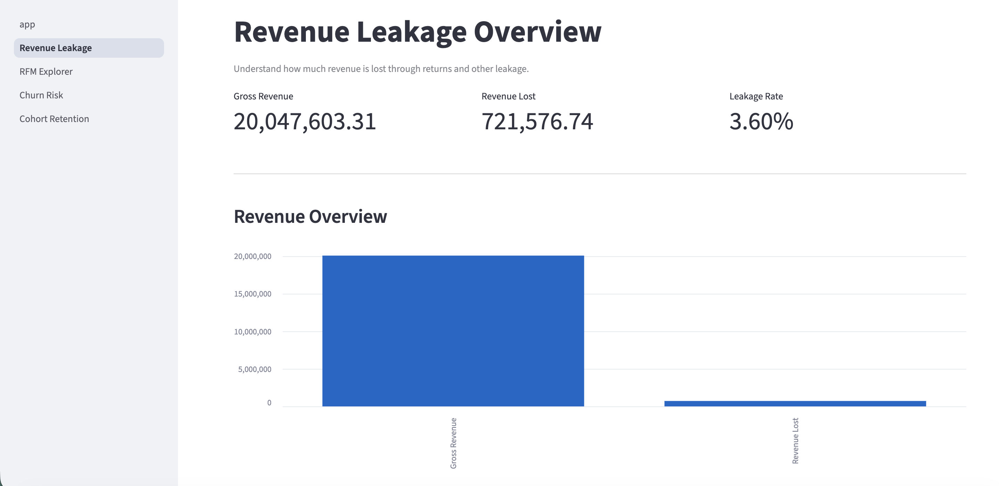
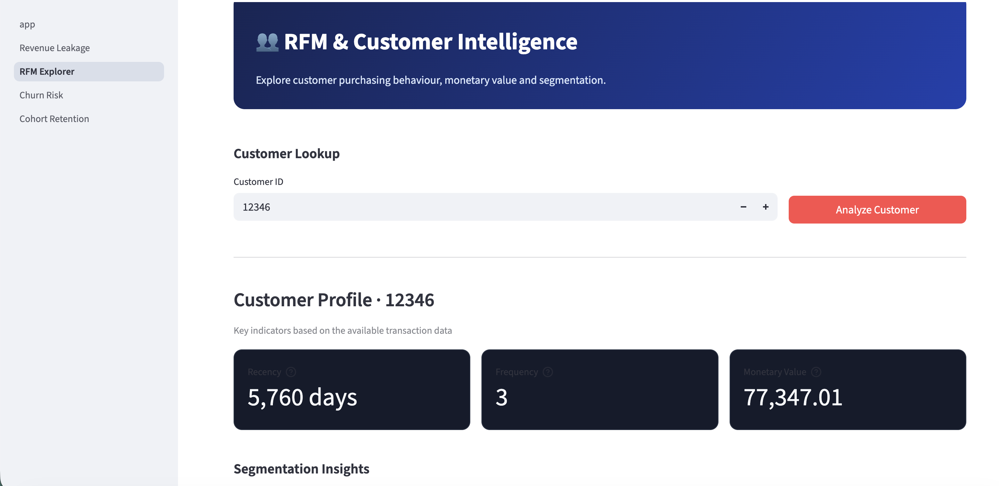
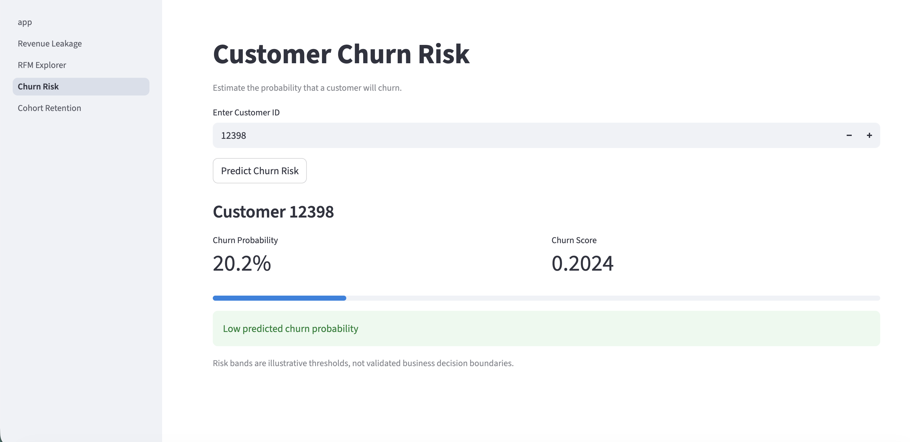
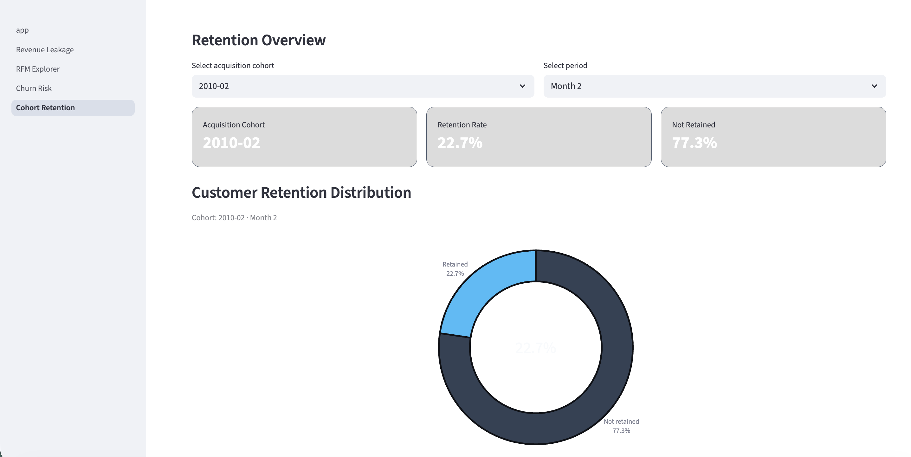

# Online Retail II — Production-Style BI & ML Project

An end-to-end Business Intelligence and Machine Learning project built on the **Online Retail II** dataset. The project combines business analysis, customer segmentation, churn prediction, a REST API, and an interactive dashboard to turn transactional data into actionable business insights.

## Project Overview

Online retailers need to understand where revenue is lost, which customers generate the most value, and which customers may stop purchasing.

This project addresses these questions through a complete analytics workflow, from data preparation and SQL-based analysis to machine learning and dashboard delivery.

### Key Questions

- **Revenue Leakage:** How much revenue is lost through returns, and where is the impact concentrated?
- **Customer Segmentation:** Which customers are most valuable based on Recency, Frequency, and Monetary value (RFM)?
- **Customer Churn:** Which customers are at risk of becoming inactive?
- **Cohort Retention:** How does customer activity evolve after the first purchase?
- **Customer Lifetime Value:** Which customers contribute the most historical revenue?

## Key Findings

### Revenue Leakage

- Total revenue lost through returns: approximately **€721.6K**.
- The United Kingdom accounts for approximately **88.3%** of the identified return value.
- December 2011 recorded the highest monthly leakage rate in the analysis, at **28.31%**.

### Customer Segmentation

- Guest transactions without an identifiable customer ID are excluded from individual customer analysis.
- RFM variables show substantial right-skewness, particularly Frequency and Monetary.
- Four quantile-based buckets were selected to balance segmentation detail and interpretability.

### Churn Prediction

- Customer features are generated using time-aware snapshots.
- Snapshot 1 (March 31, 2010) is used for training, while Snapshot 2 (August 31, 2010) is reserved for testing.
- Churn is defined as no valid purchase during the following 136 days.
- The optimized XGBoost model achieved **68% accuracy** and a **PR-AUC of 0.583** on the reported evaluation.

The model is intended as an analytical demonstration. Its predictions should be evaluated further before being used for operational customer-retention decisions.

## Technology Stack

| Area | Technologies |
|---|---|
| Data analysis | Python, Pandas, NumPy |
| Database | SQLite, SQL |
| Machine learning | Scikit-learn, XGBoost |
| Hyperparameter optimization | Optuna, Bayesian Optimization |
| API | FastAPI, Pydantic |
| Interactive dashboard | Streamlit |
| Testing | Pytest |

## Project Architecture

```text
Online-Retail-II-Production-Style-BI-ML-Project/
├── api/
│   ├── main.py
│   ├── database.py
│   ├── features.py
│   ├── schemas.py
│   └── __init__.py
├── dashboard/
│   ├── app.py
│   └── pages/
│       ├── 1_Revenue_Leakage.py
│       ├── 2_RFM_Explorer.py
│       ├── 3_Churn_Risk.py
│       └── 4_Cohort_Retention.py
├── images/
│   ├── 1_Revenue_Leakage.png
│   ├── 2_RFM_Explorer.png
│   ├── 3_Churn_Risk.png
│   └── 4_Cohort_Retention.png
├── data/
│   └── online_retail.db
├── models/
│   └── churn_model.joblib
├── notebooks/
├── tests/
├── requirements.txt
└── README.md
```

*Note: The SQLite database is excluded from version control. The local database must be prepared before running the application.*

## API Endpoints

The FastAPI layer provides access to analytical results and model predictions.

| Method | Endpoint | Purpose |
|---|---|---|
| GET | `/customers/{customer_id}/rfm` | Retrieve customer RFM metrics and segment |
| GET | `/customers/{customer_id}/churn-risk` | Retrieve predicted churn probability |
| GET | `/revenue-leakage/summary` | Retrieve revenue leakage KPIs |
| GET | `/cohorts/retention` | Retrieve cohort retention data |

Interactive API documentation is available through FastAPI's Swagger UI at `/docs`.

## Getting Started

### 1. Clone the repository

```bash
git clone https://github.com/touilrihab1/Online-Retail-II-Production-Style-BI-ML-Project.git
cd Online-Retail-II-Production-Style-BI-ML-Project
```

### 2. Create a virtual environment

```bash
python3 -m venv .venv
source .venv/bin/activate
```

On Windows:

```bash
.venv\Scripts\activate
```

### 3. Install dependencies

```bash
pip install -r requirements.txt
```

### 4. Prepare the database and model

Place the prepared SQLite database at:

```text
data/online_retail.db
```

Ensure the trained model is available at:

```text
models/churn_model.joblib
```

The database and model must match the schema and feature definitions expected by the application. The raw dataset and database are not included in this repository.

### 5. Start the FastAPI server

From the project root, run:

```bash
python -m uvicorn api.main:app --reload
```

Open the API documentation:

http://127.0.0.1:8000/docs

### 6. Start the Streamlit dashboard

Open a second terminal, activate the same virtual environment, and run:

```bash
streamlit run dashboard/app.py
```

The dashboard will open in your browser, usually at:

http://localhost:8501

Keep the FastAPI server running while using the dashboard.

## Dashboard Preview

The interactive Streamlit dashboard provides a visual interface for exploring business KPIs, customer segmentation, churn predictions, and retention trends.

### 1. Revenue Leakage Analysis

Monitor revenue performance, identify financial losses from product returns, and assess overall revenue leakage.



### 2. RFM & Customer Segmentation

Explore individual customer profiles using Recency, Frequency, and Monetary (RFM) metrics to understand purchasing behaviour and customer value.



### 3. Customer Churn Risk

Evaluate predicted customer churn probabilities using the trained machine learning model through the FastAPI backend.



### 4. Cohort Retention Analysis

Visualize customer retention through interactive charts, acquisition cohort selection, and retention trends over time.



## Future Improvements

- Complete and validate RFM segment assignment.
- Add comprehensive Pytest coverage for endpoints and feature engineering.
- Strengthen request validation and error handling.
- Validate churn predictions against the intended observation dates and feature distributions.
- Improve cohort-retention visualizations and dashboard usability.
- Add automated testing and deployment workflows.

## Author

**Rihab Touil**

M.Sc. Computer Science — Technische Universität Clausthal

GitHub: [@touilrihab1](https://github.com/touilrihab1)

---

*This project was developed for portfolio and learning purposes, demonstrating an end-to-end BI/ML workflow from business analysis to API-based analytics delivery.*
